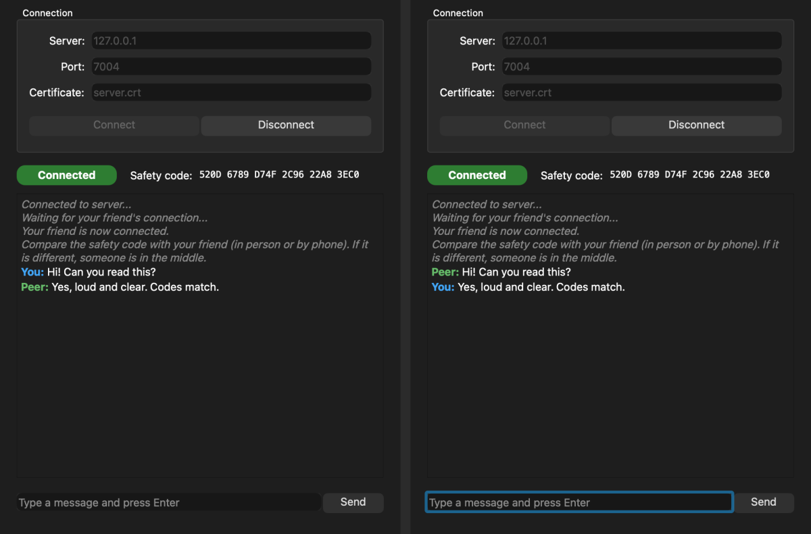

# Secure Chat Server

A small relay server for a two-person, end-to-end encrypted chat, written in Python with only the standard library. It lets two clients connect, passes their public keys to each other and forwards their messages. It cannot read the messages: they are encrypted on one client and only decrypted on the other.



*Two clients chatting through this server over TLS. The matching safety codes show the server did not swap their keys.*

## Client Application

The client application is necessary to connect to this secure chat server. You can find the client application repository and instructions on how to set it up below:

https://github.com/Arad-Afzali/secure-messaging-client-side

Please follow the installation and usage instructions in the client application's README to ensure proper communication with the server.


## Features

- Two clients per chat. A third client is turned away and the chat already running is not affected.
- Passes the clients' public keys to each other and forwards their messages. Messages are end-to-end encrypted (AES-256-GCM over an X25519 key exchange), so the server cannot read them.
- If the server swapped the keys, the safety code the two users compare would not match, so a dishonest server gets caught.
- Optional TLS with `--cert` and `--key`.
- Every message is length-prefixed (`protocol.py`), so messages are never split or merged.

## Requirements

- Python 3.x
- `openssl` (for TLS, recommended)
- No Python packages: the server only uses the standard library

## Installation

1. **Clone the repository**:

    ```bash
    git clone https://github.com/Arad-Afzali/secure-messaging-server-side.git
    cd secure-messaging-server-side
    ```

2. **Make a TLS certificate** (recommended):

    ```bash
    ./make_cert.sh
    ```

    This makes `server.crt` and `server.key` for `127.0.0.1`. Give `server.crt` to the clients and keep `server.key` private. For a real server, change the IP or domain inside the script, or use a certificate from Let's Encrypt.

## Usage

1. **Start the server**:

    ```bash
    python3 server.py --host 127.0.0.1 --port 7004 --cert server.crt --key server.key
    ```

    Without `--cert` and `--key` the server runs without TLS. The defaults are `127.0.0.1` and port `7004`.

2. **Connect clients to the server using the client application.**

    The server prints what happens, for example:

    ```text
    Server started on 127.0.0.1:7004 (TLS)
    New connection from ('127.0.0.1', 51359)
    New connection from ('127.0.0.1', 51360)
    Client ('127.0.0.1', 51359) disconnected
    Client ('127.0.0.1', 51360) disconnected
    All clients have been disconnected. Waiting for new connections...
    ```

    When one client leaves, the other is disconnected too, and the server waits for a new pair.

    
## Contributing

Contributions are welcome! Please open an issue or submit a pull request.


